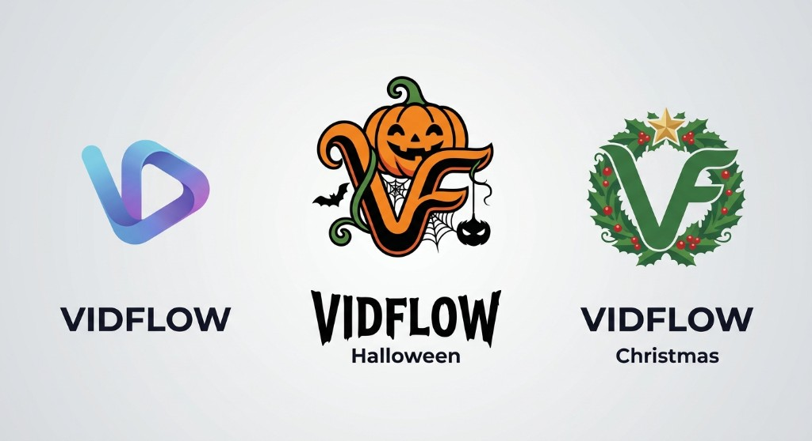
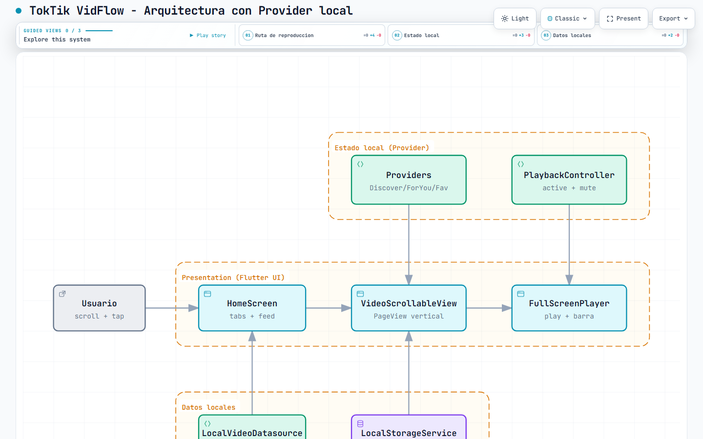
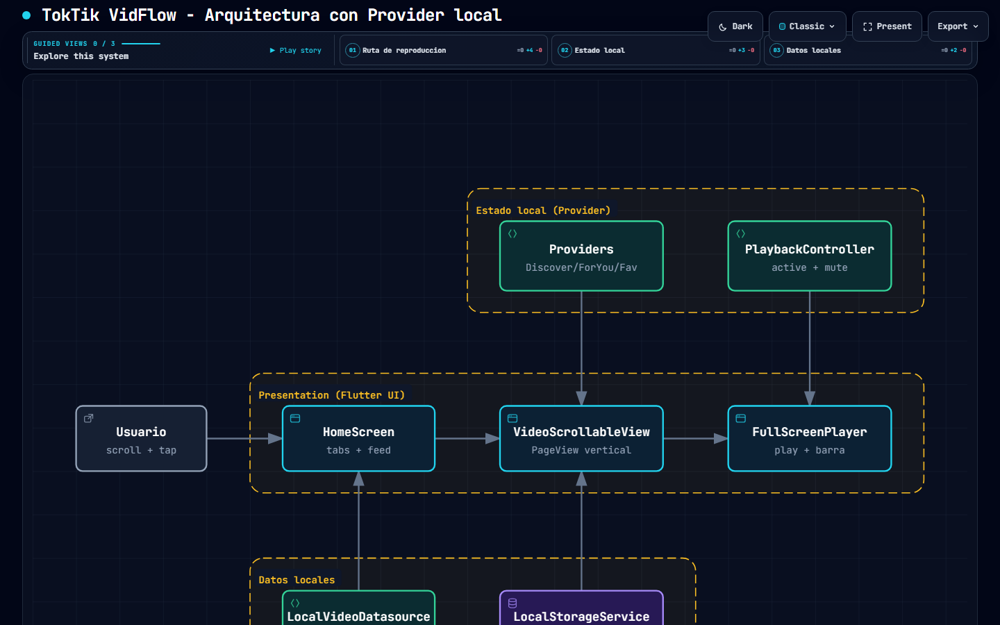
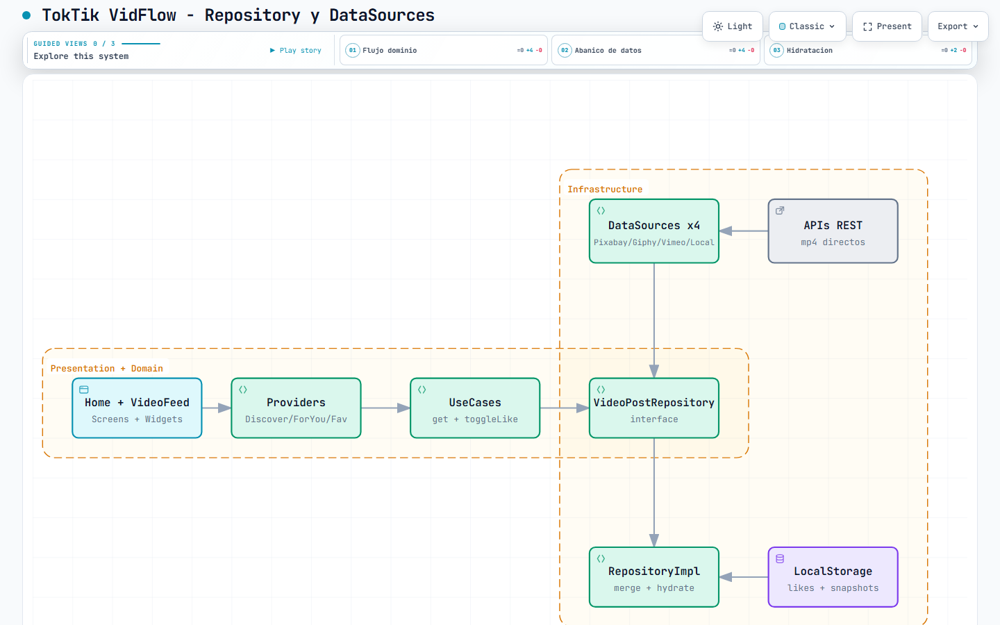
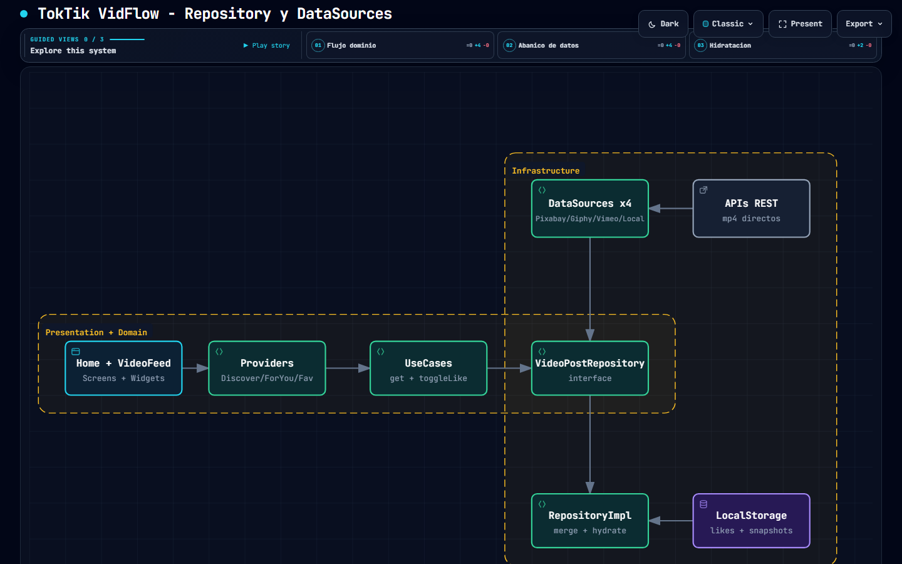

# Práctica 4: Aplicación Móvil en Flutter (TokTik VidFlow)

## Nombre de la Práctica
**Desarrollo de Aplicación Móvil estilo TikTok "VidFlow" con Feed Vertical, Controles de Video, Gestión de Estado con Provider, Arquitectura Limpia con Repository + DataSources y Temas por Temporada**

---

### Diagrama de Arquitectura
- 🌐 **[Ver Diagrama Interactivo 1: Provider local en GitHub Pages](https://giova0412.github.io/mkdir-Practicas_DMI_230314/Practica04/toktik/docs/arquitectura-toktik-provider-local.html)**
- 🌐 **[Ver Diagrama Interactivo 2: Repository y DataSources en GitHub Pages](https://giova0412.github.io/mkdir-Practicas_DMI_230314/Practica04/toktik/docs/arquitectura-toktik-repository-datasources.html)**

---

## Descripción de la Práctica
Esta práctica consiste en el desarrollo de una aplicación móvil estilo TikTok en **Flutter** para la materia de *Desarrollo Móvil Integral (DMI)*.

La aplicación muestra un feed vertical de videos a pantalla completa donde cada video se reproduce automáticamente al quedar visible. Incluye controles visibles de reproducción: botón play/pausa, tiempos actual/total y barra de progreso que permite adelantar o atrasar el video al tocar o arrastrar.

Principales características implementadas:
- **Feed vertical estilo TikTok:** `PageView` vertical con `VideoScrollableView`, un solo video activo a la vez.
- **Controles de video visibles:** botón play/pausa, icono central grande en pausa, tiempo `actual / total` y `VideoProgressIndicator` con `allowScrubbing: true`.
- **Gestión de Estado Global:** patrón **Provider** (`DiscoverProvider`, `ForYouProvider`, `FavoritesProvider`, `PlaybackController`, `SeasonThemeManager`).
- **Arquitectura Limpia (Clean Architecture):** separación en capas (`domain`, `infrastructure`, `presentation`, `config`).
- **Repository + 4 DataSources:** `VideoPostsRepositoryImpl` fusiona Pixabay + Giphy + Vimeo + Local con `Future.wait`, `_merge` sin duplicados y `_hydrate` de likes.
- **MP4 livianos para emulador:** Pixabay prefiere `tiny/small/medium` (evita 4K `large` que el decoder goldfish marca `NoSupport`), Giphy prefiere variantes `*_small`, Vimeo usa MP4 públicos de muestra.
- **Likes persistentes:** `LocalStorageService` con `SharedPreferences` guarda favoritos y snapshots.
- **Temas por temporada:** normal, halloween, christmas, valentine con logos y colores propios.

---

## Objetivo de la Práctica
- Comprender el manejo del estado global en Flutter con el paquete `provider` (`ChangeNotifier`, `MultiProvider`, `Consumer`).
- Aplicar arquitectura limpia con repository, datasources, mappers, entidades y casos de uso.
- Integrar múltiples APIs REST de video (Pixabay, Giphy, Vimeo) con fallback local sin internet.
- Implementar reproducción de video con `video_player`: play/pausa, barra de progreso con scrubbing y tiempos.
- Persistir datos locales (likes/favoritos) y aplicar temas dinámicos por temporada.

---

## Resultados Obtenidos

### 1. Logos de la Aplicación (VidFlow por temporada)

### 2. Video de Evidencia
🎬 **[Ver video de evidencia](./assets/evidencias/20261016-1937-02.2638263.mp4)**

<video src="./assets/evidencias/20261016-1937-02.2638263.mp4" controls width="360"></video>

> El video muestra el feed vertical funcionando, los controles play/pausa visibles y la barra para adelantar/atrasar cada video.

---

### 3. Diagramas de Arquitectura (generados con Archify)

#### 3.1 Arquitectura con Provider local
Describe el flujo en memoria sin internet: UI → Providers → Datasource local + Storage.
- `HomeScreen` arma tabs + feed; `VideoScrollableView` detecta la página activa con `setActive(section, index)`.
- `DiscoverProvider / ForYouProvider / FavoritesProvider` exponen listas con `notifyListeners`.
- `PlaybackController` define `activeKey` y `muted`; `FullScreenPlayer` reproduce solo si `play == true`.
- `LocalVideoDatasource` lee `assets/videos/*.mp4`; `LocalStorageService` hidrata likes.

#### 3.2 Arquitectura con Repository y DataSources
Describe la arquitectura limpia completa con red.
- `Presentation` (UI + Providers) → `Domain` (UseCases + `VideoPostRepository` interface + entidades) → `Infrastructure` (`RepositoryImpl` + 4 datasources + mappers + storage) → `APIs REST` externas.
- `RepositoryImpl.getDiscoverVideos / getForYouVideos` hace `Future.wait` a las 4 fuentes con `_safe` (si una falla devuelve `[]`), luego `_merge` (dedup por id) y `_hydrate` (aplica likes guardados).
- Mappers (`PixabayVideoMapper`, `GiphyVideoMapper`) eligen MP4 liviano y fallback a `SampleNetworkVideos` (360p/720p).

> Diagramas interactivos: ver links de GitHub Pages al inicio de este README. Generados con la skill Archify (validación showcase 9/9, 0 errores, 0 warnings; spec + artifact con SHA-256 en el receipt de `deliver`).
