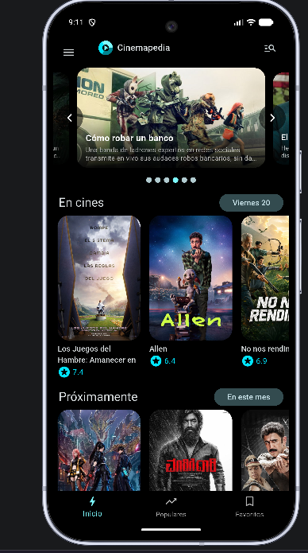
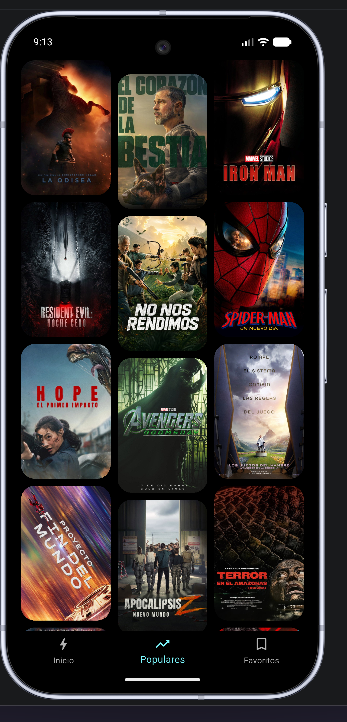
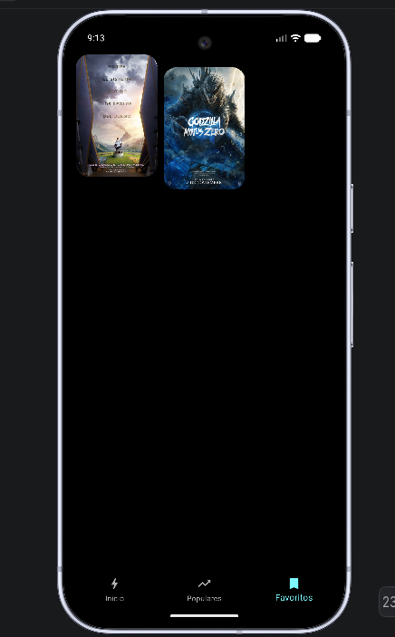
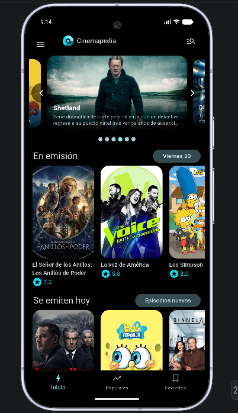
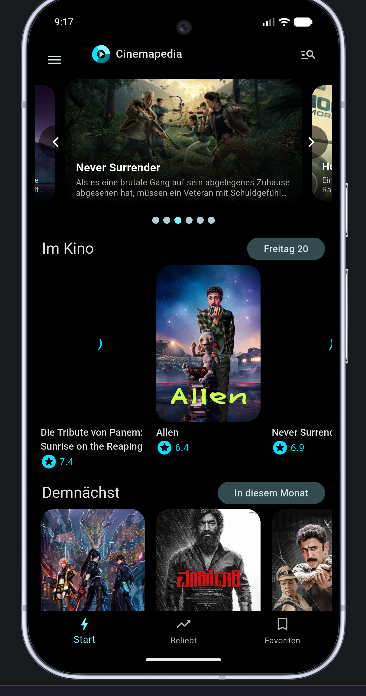
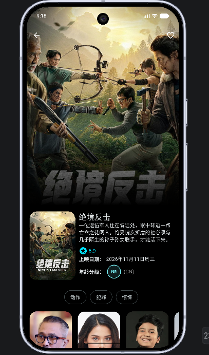
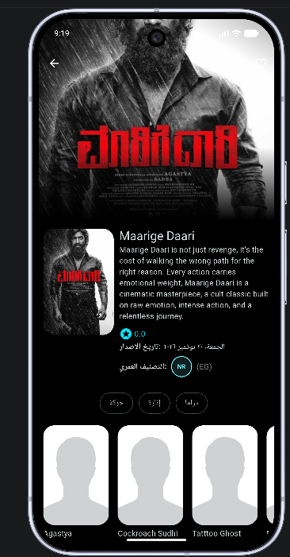
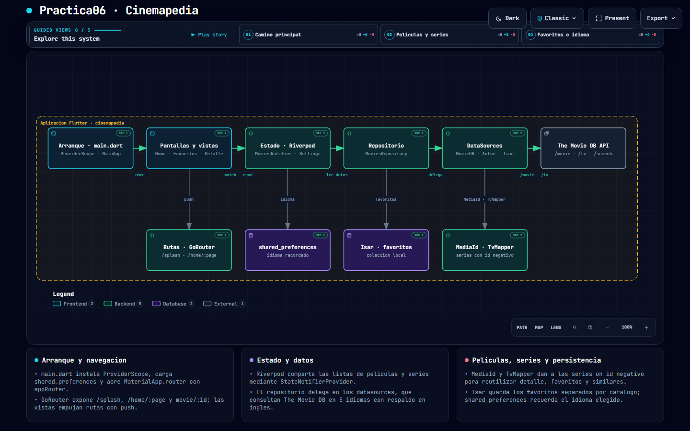

<div align="center">

# Cinemapedia

**Tu enciclopedia de cine, con estilo neón.**

Descubre películas de acción y aventura **y series de TV**, revisa el detalle de cada una y guarda
tus favoritas, en 5 idiomas.


</div>

## Sobre la app

**Cinemapedia** es una aplicación de cine y series hecha con Flutter que consume la API de
[The Movie DB](https://www.themoviedb.org/). Muestra un catálogo de **películas** o de **series de
TV** (se cambia desde **Configuración**, en el menú lateral) con el detalle de cada una, incluyendo
reparto, tráilers y títulos similares.

La app está disponible en **5 idiomas** (español de México, inglés, alemán, chino y árabe) y se
cambia desde el menú lateral: se traducen tanto los textos de la app como los datos de las
películas y series que llegan de la API.

> **Identidad visual propia:** tema **cian neón sobre negro**, logo de **aro con botón de play**,
> banderas de idioma y clasificaciones de edad **circulares**. El catálogo de películas se arma con
> títulos de **acción y aventura**.

## Demo en vivo

Pruébala en el navegador con **Appetize**, sin instalar nada:

🔗 [https://appetize.io/app/b_xlecwtbunrrsvg666fwknexctq](https://appetize.io/app/b_xlecwtbunrrsvg666fwknexctq)

[](https://appetize.io/app/b_xlecwtbunrrsvg666fwknexctq)

## Capturas

<div align="center">

### Películas

| Inicio | Populares | Detalle |
| :---: | :---: | :---: |
|  |  |  |

| Clasificación y puntuación | Favoritos |
| :---: | :---: |
|  |  |

### Series

| Contenido de series | Series |
| :---: | :---: |
|  |  |

| Series populares | Series favoritas |
| :---: | :---: |
|  |  |

### Idiomas

| English | Deutsch | 中文 | العربية |
| :---: | :---: | :---: | :---: |
|  |  |  |  |

</div>

## Funcionalidades

- **Pantalla de carga animada:** el logo (aro con botón de play) se dibuja sobre fondo negro,
  aparece el nombre y hace zoom hacia la pantalla principal. Mientras cargan las películas, el logo
  late en el centro de la pantalla.
- **Configuración en el menú lateral:** elige **Contenido** (_Películas_ o _Series_) y el **Idioma**
  de la app (ver [Configuración](#configuración)).
- **Carrusel de estrenos** con autoplay, flechas para cambiar de título y, sobre cada imagen,
  el nombre con una descripción corta.
- **Listas horizontales** con scroll infinito: _En cines_, _Próximamente_ y _Mejor calificadas_
  (con series cambian a _En emisión_, _Se emiten hoy_ y _Mejor calificadas_).
- **Populares** en una vista de cuadrícula tipo masonry.
- **Detalle del título:** sinopsis, géneros, reparto, tráilers de YouTube, títulos similares y
  clasificación de edad según el país del idioma elegido (ver [Clasificación de edad](#clasificación-de-edad)).
- **Búsqueda** de películas o series con sugerencias en tiempo real.
- **Favoritos** guardados en el dispositivo (base de datos local con Isar), separados por
  películas y series.
- **Menú lateral** que se abre con el botón de la barra o deslizando desde el borde de la pantalla.
- **Selector de idioma** con banderas circulares: español, inglés, alemán, chino y árabe
  (ver [Idiomas de la app](#idiomas-de-la-app)).
- **Tema oscuro** con fondo negro puro y acentos **cian neón**.

## Configuración

El menú lateral tiene un apartado de **Configuración**, abierto por defecto, con dos opciones:

- **Contenido:** cambia entre **Películas** y **Series**. Al cambiar se recargan solas todas las
  listas, el carrusel, la búsqueda, los favoritos y la vista de populares del catálogo elegido. Las
  series se piden a los endpoints `/tv/*` de The Movie DB (_En emisión_, _Se emiten hoy_,
  _Populares_, _Mejor calificadas_).
- **Idioma:** español, inglés, alemán, chino y árabe. El idioma elegido **se recuerda** en el
  dispositivo (ver [Idiomas de la app](#idiomas-de-la-app)).

En el código, estas dos opciones son los providers `catalogTypeProvider` y `languageProvider`
(este último guarda el idioma con `shared_preferences`).

## Catálogo

Para dar una identidad distinta, el catálogo no usa las listas genéricas de estrenos. Se arma con
el endpoint `/discover/movie` de The Movie DB filtrando por los géneros **Acción (28)** o
**Aventura (12)**, de modo que las secciones muestran películas de acción (muchas con coches y
persecuciones). Cada sección conserva su significado original:

| Sección | Orden |
| ------- | ----- |
| En cines | Acción y aventura estrenadas recientemente (hasta hoy) |
| Próximamente | Acción y aventura que se estrenan a partir de hoy |
| Mejor calificadas | Acción y aventura mejor calificadas de todos los tiempos |
| Populares | Acción y aventura ordenadas por popularidad |

La búsqueda, los títulos similares y los favoritos siguen funcionando igual que siempre.

El catálogo de **series** usa las listas propias de The Movie DB, con las mismas secciones:

| Sección | Endpoint |
| ------- | -------- |
| En emisión | `/tv/on_the_air` |
| Se emiten hoy | `/tv/airing_today` |
| Mejor calificadas | `/tv/top_rated` |
| Populares | `/tv/popular` |

### Películas y series en el mismo código

Para no duplicar pantallas, rutas, favoritos, tráilers o reparto, una serie se maneja dentro de la
app como un `Movie` con el **id en negativo** (`-id de TMDB`), porque TMDB puede repetir el mismo
número de id entre una película y una serie. La clase `MediaId`
(`lib/config/helpers/media_id.dart`) dice si un id es de serie y permite volver al id real de la
API; el mapper `TvMapper` (`lib/infrastructure/mappers/tv_mapper.dart`) convierte la respuesta de
`/tv/*` a la entidad `Movie`.

## Idiomas de la app

Al elegir un idioma en el menú lateral cambia **todo**: los textos de la app (menú inferior,
secciones, búsqueda, favoritos, pantalla de carga, detalle) y los datos de la API (títulos,
sinopsis, géneros, reparto y tráilers). Las películas y series se recargan solas con el nuevo idioma.

| Bandera | Idioma  | Código API |
| :-----: | ------- | :--------: |
|    MX   | Español |  `es-MX`   |
|    US   | English |  `en-US`   |
|    DE   | Deutsch |  `de-DE`   |
|    CN   | 中文      |  `zh-CN`   |
|    EG   | العربية |  `ar-EG`   |

- **Banderas circulares:** cada bandera se dibuja en código (`CustomPainter`) con forma redonda y
  un borde cian.
- **Respaldo en inglés:** si una película no tiene traducción en el idioma elegido, The Movie DB
  devuelve el título original y la sinopsis vacía. En ese caso la app pide también la versión en
  inglés y la usa como respaldo.
- **Diseño de izquierda a derecha:** la pantalla no se voltea, ni siquiera en árabe.
- **Fechas:** el formato de fecha del detalle y la etiqueta del día en _En cines_ siguen el idioma elegido.
- **El idioma elegido se recuerda:** se guarda en el dispositivo con `shared_preferences`, así que al
  volver a abrir la app arranca en el último idioma que elegiste (por defecto, español de México).
- Los favoritos conservan el título y la sinopsis en el idioma en que se guardaron.

<details>
<summary><b>Cómo agregar otro idioma</b></summary>

<br />

1. Agrégalo a la lista `AppLanguages.all` en `lib/config/i18n/app_language.dart`.
2. Agrega sus textos en `lib/config/i18n/app_strings.dart` (mapa `_values` y lista `supportedCodes`).
3. Si usa una bandera nueva, dibújala en `lib/presentation/widgets/shared/flag_icon.dart`.

</details>

## Clasificación de edad

En el detalle de cada película o serie, debajo de la fecha de estreno, se muestra la clasificación
de edad **del país del idioma elegido**. La etiqueta es un **círculo cian**: al cambiar el idioma en
el menú lateral y abrir otro título, el texto cambia al sistema de clasificación de ese país.

| País | Sistema | Cómo se ve |
| :--: | ------- | ---------- |
| MX | Clasificación mexicana | `AA`, `A`, `B`, `B15`, `C`, `D` |
| US | MPA (películas) / TV Parental (series) | `G`, `PG`, `PG-13`, `R`, `NC-17` / `TV-14`, `TV-MA` |
| DE | FSK | `FSK 0`, `FSK 6`, `FSK 12`, `FSK 16`, `FSK 18` |
| CN | Sin dato en The Movie DB (normalmente) | `NR` |
| EG | Equivalencia de EE. UU. | `General`, `+12`, `+16`, `+18`, `BN` |

- **De dónde sale:** de `/movie/{id}/release_dates` para películas y de `/tv/{id}/content_ratings`
  para series. Se toma la clasificación del país y, en películas, se prefiere la del estreno en cines.
- **Egipto (EG):** The Movie DB no maneja ese país, así que se usa la clasificación de EE. UU. como
  equivalente (`General`, `+12`, `+16`, `+18`). El prefijo **BN** (prohibido) se reserva para los
  títulos vetados, que se agregan a mano en la lista `AgeRatings.egyptBannedIds`.
- **Sin clasificación:** si el país no tiene dato (o el título es muy nuevo), se muestra **NR**
  (sin clasificar).
- **Dónde está en el código:** `getCertification` en `moviedb_datasource.dart`, el provider
  `movie_certification_provider.dart` y el formato en `lib/config/helpers/age_rating.dart`.

## Logo e icono

El logo de Cinemapedia es un **aro cian con un botón de reproducción (play)** dentro. Es el mismo
dibujo en toda la app: barra superior, menú lateral y pantalla de carga. Se dibuja en código con
`CustomPainter` (`lib/presentation/widgets/shared/cinemapedia_logo.dart`), por eso se ve nítido a
cualquier tamaño y no depende de ninguna imagen externa.

Ese mismo dibujo es el **icono de la aplicación** en todas las plataformas (Android, iOS, Windows,
macOS y web), así que ya no se usa el logo de Flutter. Las imágenes se generan dibujando el logo en
código con `tool/generate_icons.dart` y luego se reparten con `flutter_launcher_icons`:

```powershell
dart run tool/generate_icons.dart     # dibuja assets/icon/*.png y el logo del arranque
dart run flutter_launcher_icons       # genera los iconos de cada plataforma
```

Solo hay que volver a ejecutarlos si cambias el dibujo del logo.

Además, la **pantalla de arranque nativa** (la que aparece un instante antes de que Flutter dibuje)
es negra con el logo al centro, así no hay ningún destello blanco al abrir la app; enseguida
continúa el splash animado de Flutter.

## Paleta de colores

| Color               |    Hex    | Uso |
| :------------------ | :-------: | :-- |
| **Cian base**       | `#00E5FF` | Color de la marca y semilla del tema |
| **Cian oscuro**     | `#00838F` | Segmento bajo del aro y detalles |
| **Cian neón claro** | `#7DF9FF` | Acentos, color principal de la interfaz (puntos del carrusel, barra inferior, corazón de favoritos) |
| **Negro**           | `#000000` | Fondo de la app, de la pantalla de carga y de la barra superior |
| **Blanco**          | `#FFFFFF` | Textos e iconos sobre fondo oscuro |

> Los colores están centralizados en `lib/config/theme/app_theme.dart` (`AppTheme`).

## Tecnologías

| Para qué             | Paquete                          |
| -------------------- | -------------------------------- |
| Estado               | `flutter_riverpod`               |
| Navegación           | `go_router`                      |
| Peticiones HTTP      | `dio`                            |
| Base de datos local  | `isar_community`                 |
| Preferencias         | `shared_preferences`             |
| Carrusel             | `card_swiper`                    |
| Animaciones          | `animate_do`                     |
| Cuadrícula           | `flutter_staggered_grid_view`    |
| Tráilers             | `youtube_player_flutter`         |
| Variables de entorno | `flutter_dotenv`                 |
| Fechas e idiomas     | `intl` y `flutter_localizations` |

## Arquitectura

La app se divide en capas:

- **Configuración y arranque:** tema, router, textos e idiomas (`lib/config/`).
- **Presentación y estado:** pantallas, vistas, widgets y providers de Riverpod (`lib/presentation/`).
- **Dominio:** entidades, contratos de datasources y repositorios (`lib/domain/`).
- **Infraestructura:** implementación de datasources y repositorios, modelos y mappers
  (`lib/infrastructure/`), incluido `TvMapper` para las series.
- **Servicios externos:** The Movie DB (películas en `/movie/*` y series en `/tv/*`), imágenes de
  TMDB y YouTube.
- **Almacenamiento local:** Isar (favoritos) y `shared_preferences` (idioma elegido).

Los providers piden las películas o series al repositorio, que las trae de The Movie DB y las
convierte a entidades con mappers. Como una serie se representa como un `Movie` con id negativo,
toda la interfaz (detalle, favoritos, búsqueda, reparto, tráilers y similares) sirve para ambos
catálogos sin código extra.

### Diagrama de arquitectura

[Ver el diagrama interactivo en GitHub Pages](https://giova0412.github.io/mkdir-Practicas_DMI_230314/Practica06/arquitectura/arquitectura-practica06.html)



## Requisitos

- **Flutter estable reciente** (Dart ^3.10, Gradle 9.3.1, AGP 9.1.0, Kotlin 2.4.0). Si tu Flutter es
  más viejo: `flutter upgrade`.
- **JDK 17 o superior** (el que trae Android Studio sirve).
- Android SDK 36 (Android Studio lo instala solo cuando se lo pide el build).
- Una API key gratuita de [The Movie DB](https://www.themoviedb.org/settings/api).

## Cómo ejecutarlo

1. Crea un archivo `.env` en la raíz del proyecto con tu API key:
   ```
   THE_MOVIEDB_KEY=tu_api_key
   ```
2. Instala las dependencias:
   ```
   flutter pub get
   ```
3. Ejecútalo en Windows, en un emulador o en tu celular (con depuración USB activada):
   ```
   flutter devices
   flutter run
   ```

> **La web no está soportada:** Isar no corre en navegador.

## Generar el APK

Desde la raíz del proyecto, en PowerShell, este comando genera el APK y lo copia al escritorio como
`Cinemapedia.apk`:

```powershell
flutter build apk --release; if ($?) { Copy-Item build\app\outputs\flutter-apk\app-release.apk "$([Environment]::GetFolderPath('Desktop'))\Cinemapedia.apk" -Force }
```

El archivo original queda en `build/app/outputs/flutter-apk/app-release.apk`.

> El `.env` va dentro del APK, así que no lo subas a una tienda pública. Además, el APK sale
> firmado con la llave de depuración: sirve para instalarlo y mostrarlo, no para publicarlo.

## Créditos

- Datos de películas: [The Movie DB](https://www.themoviedb.org/). Esta app usa la API de TMDB
  pero no está avalada ni certificada por TMDB.
