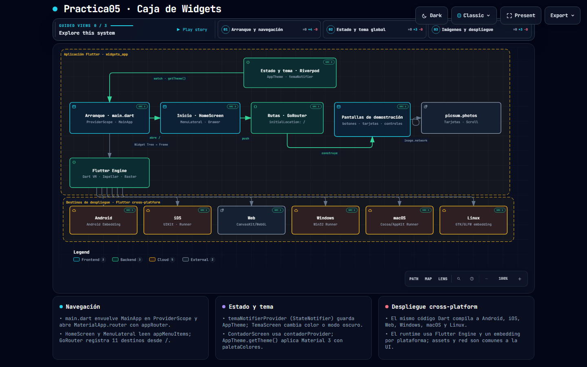
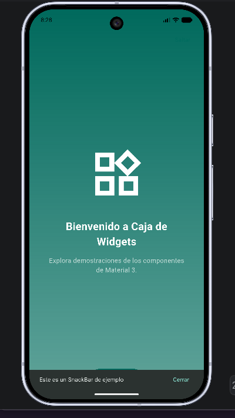
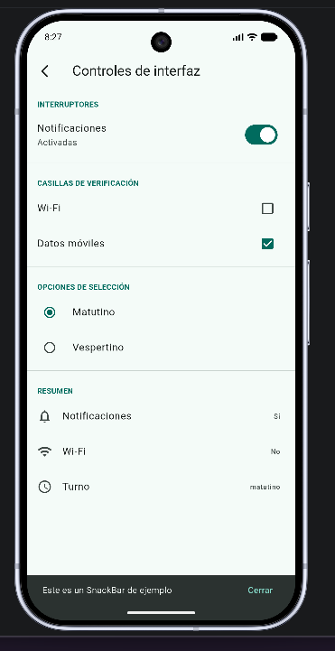
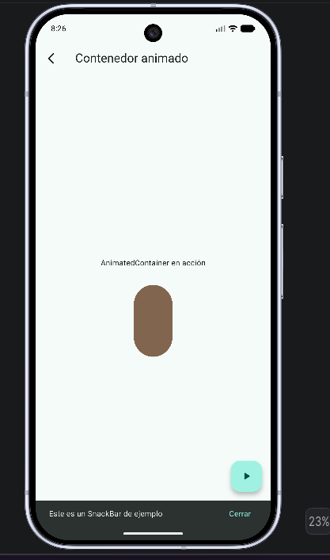
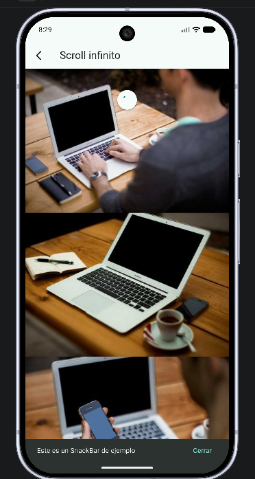
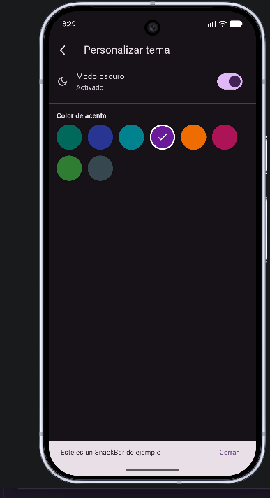
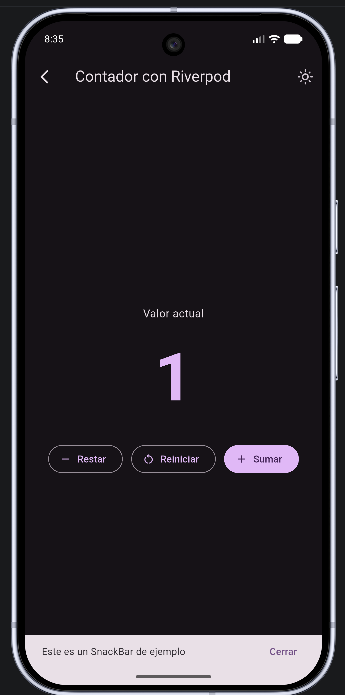
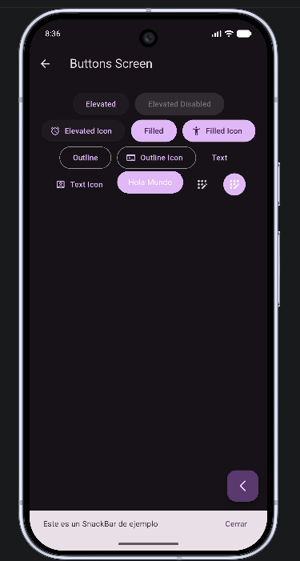
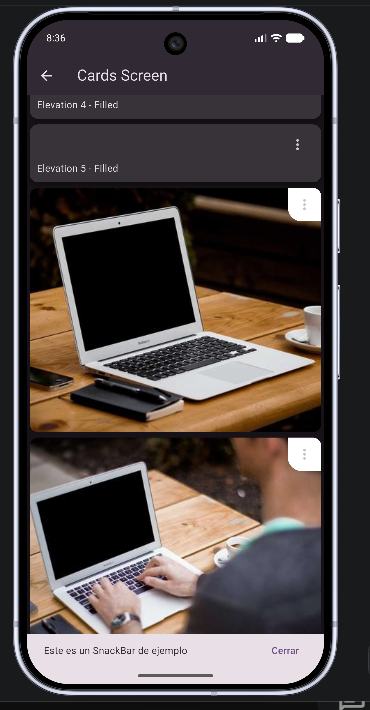
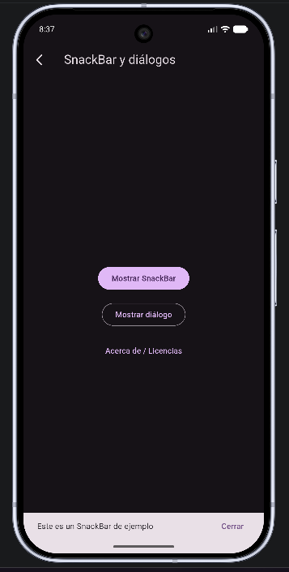

# Práctica 05 — Caja de Widgets (`widgets_app`)

**Desarrollo Móvil Integral · Giovany Raúl Pazos Cruz**

## Objetivo

Construir una aplicación de ejemplo en Flutter que reúna, en un mismo catálogo,
demostraciones de widgets de Material 3, navegación declarativa entre pantallas y
manejo de estado con Riverpod. Cada entrada del menú lateral abre una pantalla que
muestra un componente o interacción distinto.

## Diagrama de arquitectura

[Ver el diagrama interactivo en GitHub Pages](https://giova0412.github.io/mkdir-Practicas_DMI_230314/Practica5/arquitectura/arquitectura-practica05.html)



## Funcionalidades

- **Menú lateral y navegación:** un `NavigationDrawer` propio (`MenuLateral`) lista las
  demostraciones y empuja rutas declaradas con `GoRouter`.
- **Contador reactivo:** el valor se guarda en un `StateProvider` de Riverpod y se
  actualiza desde botones de sumar, restar y reiniciar.
- **Botones y tarjetas:** variantes de botones Material 3 y tarjetas con distintos
  niveles de elevación y contenido.
- **Indicadores de progreso:** indicadores circulares y lineales, incluidos ejemplos de
  progreso controlado.
- **Mensajes y diálogos:** `SnackBar`, diálogo de confirmación y la información de la app.
- **Contenedor animado:** cambia de forma aleatoria el tamaño, el color y el radio de un
  `AnimatedContainer`.
- **Controles de interfaz:** interruptores, casillas de verificación y un grupo de
  opciones de selección (`RadioGroup`).
- **Tutorial:** carrusel de introducción de tres páginas con opciones para saltar o
  continuar.
- **Scroll infinito:** carga imágenes de `picsum.photos` al desplazarse y permite
  recargar la lista con un gesto de arrastre.
- **Personalización del tema:** selector global de modo claro/oscuro y de color de acento.

## Descripción de la solución

`main.dart` arranca la aplicación dentro de un `ProviderScope` y configura
`MaterialApp.router`. `MainApp` es un `ConsumerWidget` que observa el estado del tema y
aplica el `ThemeData` de Material 3 en toda la interfaz.

El estado se reparte en tres providers:

- `paletaProvider` expone la lista de colores disponibles.
- `temaNotifierProvider` (`StateNotifier`) guarda el modo claro/oscuro y el índice de
  color seleccionado.
- `contadorProvider` (`StateProvider`) mantiene el valor del contador.

`GoRouter` registra la pantalla de inicio y las diez demostraciones. La pantalla de inicio
(`HomeScreen`) muestra la lista de `appMenuItems` y expone el `MenuLateral` como cajón de
navegación.

## Tecnologías utilizadas

- Flutter y Dart con Material 3
- `flutter_riverpod` para el estado del tema y del contador
- `go_router` para la navegación declarativa
- `animate_do` para animaciones de entrada
- Imágenes remotas de `picsum.photos`

## Evidencia de funcionamiento

<table>
  <tr>
    <th align="center">Tutorial</th>
    <th align="center">Controles de interfaz</th>
    <th align="center">Contenedor animado</th>
  </tr>
  <tr>
    <td align="center"></td>
    <td align="center"></td>
    <td align="center"></td>
  </tr>
  <tr>
    <th align="center">Scroll infinito</th>
    <th align="center">Personalización del tema</th>
    <th align="center">Contador con Riverpod</th>
  </tr>
  <tr>
    <td align="center"></td>
    <td align="center"></td>
    <td align="center"></td>
  </tr>
  <tr>
    <th align="center">Botones Material 3</th>
    <th align="center">Tarjetas</th>
    <th align="center">SnackBar y diálogos</th>
  </tr>
  <tr>
    <td align="center"></td>
    <td align="center"></td>
    <td align="center"></td>
  </tr>
</table>

## Cómo ejecutar el proyecto

Desde la carpeta `Practica5/widgets_app`:

```bash
flutter pub get
flutter run
```

## Autor

Giovany Raúl Pazos Cruz — repositorio `mkdir-Practicas_DMI_230314`.
